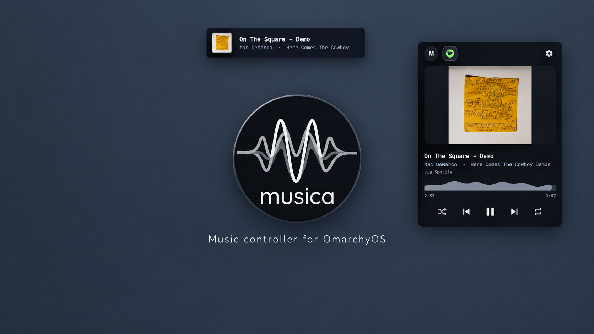

# Musica

<p align="center">
  
</p>

<p align="center">
  Music control for the Omarchy bar.<br>
  A live cava spectrum sits in the bar as the icon; clicking it opens a wide now-playing card.
</p>

It talks MPRIS directly, so it follows Spotify, browser YouTube, and
anything else that exposes the standard Linux media interface.



## Features

- **Bar icon:** live mini-cava, or the song name (switch in settings)
- **Card:** per-source tabs with app icons, big artwork with a fallback
  chain for browsers, wave seek bar, shuffle + repeat that stay dull
  without player support
- **Toast:** cover-left mini card on track change and transport actions,
  click raises the player app
- **Sound console:** the logo in the card opens a floating window with three
  tabs: a system-wide 10-band equalizer (six use modes, the eight Winamp
  classics, and a curve you hear while you drag it), a level per output device
  from 0 to 150%, and the plugin's settings
- **Keybinds** ship in the plugin (`SUPER+ALT+P/N/B/S`), plus direct IPC
- **Settings** persist to `shell.json`: bar look, toast on/off + spot,
  and every toggle takes effect instantly

## Install

```sh
omarchy plugin add https://github.com/FearThePLOTO/Musica.git --enable
omarchy bar put io.github.feartheploto.musica --section right
```

Local dev instead: `./scripts/dev-install` (restarts the shell), undo with
`./scripts/dev-uninstall`. Those two helpers are gitignored dev tools,
not part of the plugin.

## Use

- Left click: open/close the card · middle click: play/pause · scroll: prev/next
- Tabs (top, one per source): click to switch source; dot = playing
- Seek bar: drag to move; dull when the player can't seek
- Equalizer icon (card header): open the sound mixer; `Esc` or a click
  outside closes it
- Card keys: `Space` play/pause, `n` next, `p` previous, `s` cycle source,
  `Esc` close, `Tab` hop panels
- Keybinds (opt-in, installed by the plugin itself):

  ```sh
  ./scripts/musica-keybinds install   # SUPER+ALT+P / N / B / S
  ./scripts/musica-keybinds remove
  ```

  Direct IPC also works:
  `omarchy-shell musica playPause|next|previous|cycleSource|toggle|mixer`
- Toast stays silent while the card is open. With built-in
  omarchy.media still enabled, its own text OSD fires too; ours
  covers our tab only.

## Sound mixer

The logo in the card header opens a floating sound console with three tabs:
the equalizer, the output devices, and the plugin's own settings.

The equalizer is built the way Omarchy builds speaker tuning, as a PipeWire
filter chain in a transient user unit reading a config from the session runtime
directory. So it installs nothing, writes no `~/.config` file, never restarts
your audio server, and disappears at logout.

- **Modes:** Normal (flat), then Music, Movie, Voice and Night, which are
  shaped for what you are doing rather than for a genre. Custom keeps your own
  curve. The eight below the divider are Winamp's original presets (Laptop,
  Rock, Pop, Classical, Club, Dance, Techno, Soft), converted on Winamp's own
  scale, so they are the curves people already know.
- **Faders:** ten bands from 60 Hz to 16 kHz. Dragging one turns the mode into
  Custom, starting from the curve that was showing. A change lands while you are
  still dragging, because the new curve is swapped into the sink that is already
  playing: nothing stops, nothing is moved, and you hear the curve you are
  shaping. Right-click a fader to put that band back at 0 dB.
- **Reset** goes back to Normal and a flat curve. The toggle at the bottom is
  the same as bypassing the whole thing.
- Your mode and curve are remembered across shell restarts. Volume keys keep
  working: the headroom the curve needs is carried by the mixer itself, so
  your volume still drives the real output device.

The **Outputs** tab lists every output device with its own level from 0 to
150%, the same ceiling Omarchy's own audio panel uses for streams. Click a row
to make that device the output, right-click its fader to mute it. Raising a
muted device unmutes it, which is what the volume keys do. When the mixer is
on it is the default output, so the levels shown are the devices underneath it:
the same resolution the volume keys make, so the console and your keyboard can
never disagree about what is loud.

The **Settings** tab holds what the card used to carry in its own popup: bar
look, track toast and where the toast lands.

Boosts cost headroom. The mixer's own level comes from the curve's true summed
peak, computed from the band filters it renders, rather than from the curve's
loudest band, so a boosted curve plays at about the level of a flat one
instead of clipping.

While the mixer is on it takes over the default output; if you switch to
headphones or HDMI, the mixer follows. Turning it off hands your output
straight back.

What it does not do:

- The graph is stereo, so a multichannel stream is downmixed through a
  two-channel path rather than passing surround through.
- There is no compressor or limiter behind the EQ, so Night is a curve and not
  a loudness evening-out.
- Omarchy's audio panel lists the mixer as one extra stream row while it is on.
- The headroom calculation assumes the 48 kHz graph Omarchy runs.
- The console floats and centers itself through a window rule it registers with
  Hyprland, so on another compositor it opens as a normal window instead.
- Past 100% a device can clip, since that is what overamplification is. The
  console says so next to the faders.

The console opens as a floating window rather than a full-screen panel, so it
behaves like any other app window: it takes no tile, and the window manager can
switch to it. Press Escape or the ✕ to close it.

The audio side is one script, `scripts/musica-mixer`: `apply` with ten band
gains, `off`, `status`, and a `selftest` that checks the band guards, the
headroom math, the volume mapping and the curve it renders. The bands, their Q
values and the headroom a curve needs live there, so the curves in the console
stay just curves. The host that owns the sink runs a pass-through graph; the
curve is loaded into the sink's own converter and replaced in place, which is
what lets a change land on music that is already playing.

## Requirements

- Omarchy Quattro
- `cava` (optional; without it the bar shows a flat resting icon)
- Any MPRIS player (Spotify, browser, …)

Artwork tries MPRIS art first, then a derived thumbnail (YouTube watch
URLs from browsers that expose no art, e.g. Zen), then the placeholder.

## Remove

```sh
omarchy plugin remove io.github.feartheploto.musica
./scripts/musica-keybinds remove
```

## Trust

Like every Omarchy shell plugin, Musica runs unsandboxed inside the
long-lived shell process with your user permissions — read the code
before enabling, as the installer itself warns. It never asks for sudo,
starts no second Quickshell process, and spawns no more than two helpers:
`cava` for the visualizer (skipped when not installed or when the bar
shows the song name instead), and — only while the sound mixer is on — a
single `pipewire` filter host in a transient user unit, which is what
plays your audio through the equalizer. The keybind helper only appends
a marked block to `~/.config/hypr/bindings.lua`; `remove` deletes
exactly that block.
